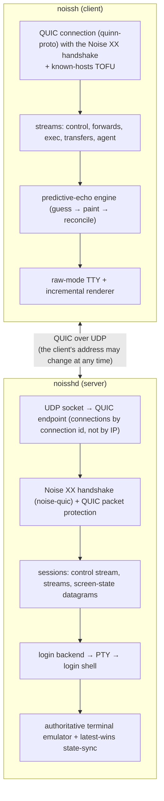
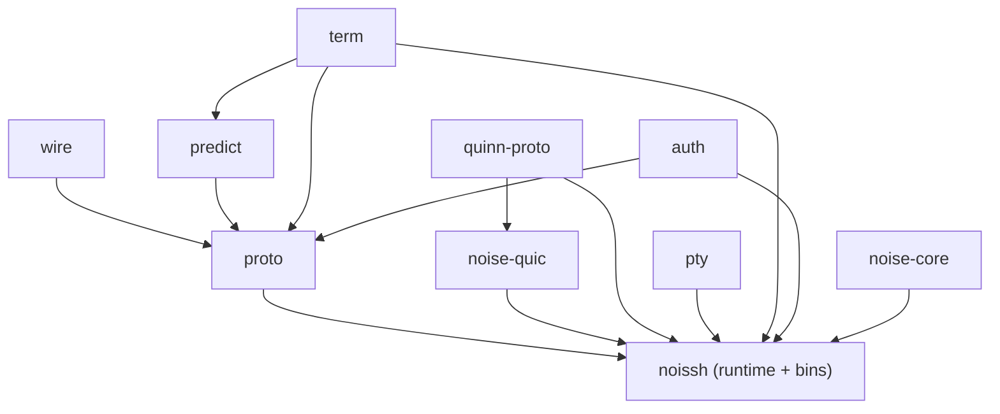

# noissh Architecture

This document describes how noissh is structured, how data flows through it, and
why the pieces are split the way they are. For the wire format and protocol
details see [PROTOCOL.md](PROTOCOL.md); for the trust/threat model see
[SECURITY.md](SECURITY.md).

Since 0.7 the transport is QUIC (`quinn-proto`) with the Noise handshake in
place of TLS; the design and its rationale are in
[design/quic-transport.md](design/quic-transport.md).

## Goals

noissh aims to be **highly resilient** and **as rich as SSH**, with all
cryptography provided by the [Noise Protocol Framework](https://noiseprotocol.org/)
("Noise all the way down"). The transport is QUIC with Noise as its handshake;
on top of it noissh adds a **latest-wins screen sync with a predictive TTY
overlay**, and SSH's feature set as QUIC streams. Account/login/privilege
machinery reuses
the operating system (the SSH bootstrap logs the user in) rather than reinventing
it. The entire codebase is `#![forbid(unsafe_code)]` — there is no `unsafe` in any
crate; OS primitives are reached through safe-API crates.

## High-level picture



## Crate layout

The project is a Cargo workspace. Each crate has one clear responsibility and is
independently testable; lower crates know nothing about higher ones.

```
crates/
  wire/        session-layer frame codec (acks, input, screen diffs, control)
               and stream kinds
  noise-core/  static X25519 keys (generation, public-key derivation)
  noise-quic/  Noise XX as the crypto layer of quinn-proto QUIC connections
  term/        authoritative terminal emulator + latest-wins screen diff
  predict/     client-side predictive-echo engine
  auth/        known_hosts (TOFU) + authorized_keys, X25519 key text format
  pty/         PTY allocation + login-shell launching (safe, via pty-process)
  proto/       control channel, state-sync plane, xfer request, auth decisions
src/           runtime: quic (QUIC config, stream table, control channel),
               client/server cores + UDP drivers, config, tty, ssh, forward
               (TCP/Unix), socks (-D), exec (remote command), xfer (file I/O)
src/bin/       noissh (client), noisshd (server), noissh-keygen (key tool)
bench/         noissh-bench: noissh vs OpenSSH over a simulated network path
```

### Dependency direction



There are no cycles. `wire`, `noise-core` and `noise-quic` (over `quinn-proto`)
are the foundations; `proto` is the session-layer integration; the root
`noissh` crate drives QUIC and adds I/O (sockets, PTYs, TTY) and the binaries.

## The two cores

A central design choice is that all protocol logic lives in **I/O-free cores**:

- `proto::ServerShell` / `proto::ClientShell` — the state-sync data plane,
  operating purely on `wire::Frame`s.
- `noissh::server::ServerCore` / `noissh::client::ClientCore` — full session
  handling around a `quinn-proto` endpoint (sans-IO QUIC): handshake and auth,
  streams, control, screen sync, detach and reattach. They consume raw
  datagrams and return raw datagrams to send. No sockets.

The `Server`/`Client` UDP drivers wrap the cores with a `UdpSocket` and a
`poll()` event loop that sleeps until the socket, a PTY, a forwarded connection
or a QUIC timer needs attention. Because the cores are socket-free, the
**resilience harness** can drive them through an in-memory shim that injects
loss/reorder and rewrites source addresses — exercising the production code
path.

## Data flow: an interactive session

1. **Handshake.** The client opens a QUIC connection; the Noise `XX` handshake
   runs in its CRYPTO frames (`noise-quic`). On completion both sides hold each
   other's authenticated static key.
2. **Trust.** The client checks the server key against `known_hosts` (TOFU) or
   the SSH-bootstrap pin; the server checks the client key against
   `authorized_keys`. Both checks happen inside the handshake, *before* any
   session state, stream or PTY exists.
3. **Shell open.** The client opens the control stream and sends `OpenShell`.
   The server allocates a PTY and execs the login shell (or hands over a
   detached shell of the same client, see below).
4. **Output (server → client).** The PTY's output feeds the authoritative
   terminal emulator. The server sends latest-wins diffs of the screen
   (`StateDiff`) as QUIC datagrams; the client applies them to its render grid
   and acks on the control stream.
5. **Input (client → server).** Keystrokes go on the control stream (reliable,
   ordered, highest priority) and are written to the PTY.
6. **Prediction.** The client predicts the visible echo of keystrokes and paints
   it immediately (distinct styling), reconciling against authoritative diffs as
   they arrive.
7. **Roaming.** QUIC connection migration moves the connection to the client's
   new address (IP change, NAT rebinding). If the connection is lost (an outage
   longer than the 60 s idle timeout, sleep), the client opens a new one and
   the server hands it the detached shell, with a full screen snapshot.

## Resilience model

- Every packet is AEAD-authenticated; the server routes by QUIC connection id,
  **not** by source IP:port, and a packet must authenticate before it can move
  a connection to a new address.
- The screen rides **unreliable latest-wins** datagrams: only the newest screen
  state matters, so packet loss never stalls the display; keystrokes ride the
  control stream, which a bulk transfer on another stream can't delay (stream
  priorities, and QUIC has no head-of-line blocking across streams).
- Loss recovery, congestion control (BBR) and flow control come from QUIC;
  replay protection from packet numbers.
- A shell outlives its connection for 15 minutes (detached), so a client can
  always come back to it (PROTOCOL.md, section 6).

## TTY / predictive echo

The server runs the only authoritative terminal emulator. The client is a "dumb"
render target plus a prediction overlay: it never re-emulates escape sequences,
it just applies cell/cursor diffs and paints predictions on top. Prediction is
**adaptive** — it only displays once the server has confirmed an echo, which
naturally suppresses predictions at non-echoing prompts (passwords).

Because the emulator is authoritative, it also answers the terminal-status
queries a shell's line editor sends at startup — cursor-position report
(`ESC[6n`) and device attributes (`ESC[c`/`ESC[>c`) — by writing the reply
straight back to the shell. A line editor blocks on these before drawing its
first prompt, so answering them is what makes the prompt appear immediately
rather than after the first keystroke.

## Streams and the SSH-rich feature set

Alongside the latest-wins interactive plane, every SSH-style feature is a QUIC
bidirectional stream of the same connection, whose header names its kind
(`noissh::quic::Streams` maps streams to the byte-pipe API the drivers use).
QUIC gives each stream reliable ordered delivery, flow control and congestion
control, and loses nothing when the client changes address:

- **Port forwarding** — local `-L`, remote `-R`, and dynamic `-D` (a local SOCKS5/4
  proxy whose `CONNECT`s open forward streams). `-R` listeners bind loopback.
- **File transfer** — `--put` / `--get`, written via a temp file and atomically
  renamed on success.
- **Agent forwarding** — `-A` exposes `SSH_AUTH_SOCK` on the server, tunnelling
  agent connections back to the client's local agent.
- **Remote command execution** — a trailing `noissh user@host <cmd>` runs a
  command under pipes (byte-exact stdout, separate stderr on a second stream,
  exit code in an `ExecExit` control message).

QUIC's anti-amplification rules (a padded first packet, at most 3× the bytes
received before the client's address is validated) prevent UDP reflection (see
[PROTOCOL.md](PROTOCOL.md) and [SECURITY.md](SECURITY.md)).

## Login & privilege model

The `pty` crate exposes a `LoginSession` trait with one backend, `LocalLogin`,
built on the safe `pty-process` crate (no `unsafe`):

- It allocates a real PTY and execs the login shell as the **current user** — no
  root required. This is the tested, default path.
- For multi-user use, the **SSH-bootstrap model** applies: the SSH bootstrap launches the
  server already running as the authenticated user, so no in-process `setuid` is
  needed.
- A standalone root daemon may optionally drop to a target user's `uid`/`gid`
  before exec (via `pty-process`'s safe API), with the supplementary-group
  caveat noted in [SECURITY.md](SECURITY.md).

Keeping the privileged surface minimal, isolating all parsing/crypto/protocol in
safe unprivileged code, and forbidding `unsafe` entirely are deliberate security
choices (see [SECURITY.md](SECURITY.md)).

## Testing strategy

- **Unit:** every crate (frame round-trip + fuzz, emulator against
  escape-sequence corpora, `apply(diff(a,b)) == b` property tests, predictive
  reconciliation; `noise-quic`: handshake between in-memory QUIC endpoints,
  rejected keys, transcript binding, loss, key update, packet and header
  protection).
- **Resilience harness:** in-process, real cores + real PTY, injecting
  loss/reorder and rewriting the source address mid-session; detach,
  reconnect after a timed-out connection, reattach.
- **Real-socket e2e:** actual `Server`/`Client` over loopback UDP, including a
  client socket rebind mid-session (roaming) and unauthorized-client rejection.
- **SSH bootstrap e2e:** a fake `ssh` launches the real one-shot server.
- **Security:** unauthorized key rejected before any session work; known_hosts
  mismatch; injected and undersized packets; deterministic fuzzing of the
  packet handler and frame parser.
- **Benchmark:** `noissh-bench` compares throughput and latency with OpenSSH
  over a simulated path (`bench/README.md`).
